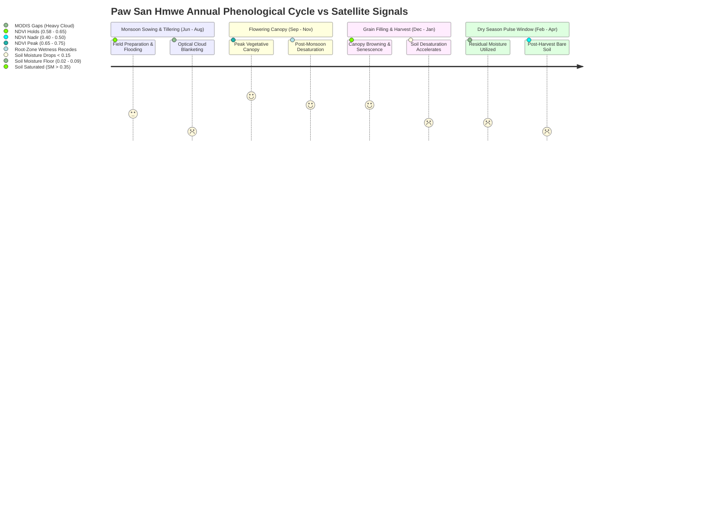

---
tags:
  - nasa/appeears
  - satellite/modis
  - satellite/smap
  - crop/pawsan
  - geography/ayeyarwady
date: 2026-11-14
status: verified
---

# AppEEARS Data Pack: Paw San Ayeyarwady & Field Shift Demo Fields

This document records the exact provenance, data inventory, QA screening verdicts, and phenological findings from the NASA AppEEARS extraction covering the Ayeyarwady Delta and Yangon agricultural regions.

---

## 1. Executive Summary & Datasets Status

| Dataset Name | AppEEARS Task ID | Status | Spatial Domain | Verification Notes |
| :--- | :--- | :--- | :--- | :--- |
| **Paw San Ayeyarwady** | `14cb26b2-28d6-4415-b328-38c29df7865e` | **COMPLETE** | 7 Delta Townships | 126 MODIS composites, 114 QA-passing SMAP field-days. Fully ingested into `data/clean/`. |
| **Field Shift Demo Fields** | `fieldshift-demo-fields` | **PENDING RE-DOWNLOAD** | Twante Demo Fields (F-01..F-06) | Task completed at 14:21 GMT+6:30; pending re-download into `data/raw/appeears/`. Fields remain honestly `NOT_CONNECTED`. |

---

## 2. Ingested Data Inventory

### 2.1 Points of Interest
- **Myaungmya** (16.60024° N, 94.92314° E) — The genetic and agricultural heartland of Paw San Hmwe rice.
- **Pathein** (16.78411° N, 94.73261° E) — Western coastal delta gateway.
- **Pyapon** (16.29498° N, 95.67052° E) — Lower delta coastal basin.
- **Bogale** (16.28596° N, 95.40944° E) — Low-lying estuarine delta.
- **Dedaye** (16.36504° N, 95.80740° E) — East delta basin (exhibits sowing anomaly).
- **Kyaiklat** (16.50877° N, 95.70505° E) — Central delta canal network.
- **Maubin** (16.72845° N, 95.64413° E) — Upper delta alluvial plain.

### 2.2 Quality Assurance (QA) Screening Gates
- **MOD13Q1.061 (MODIS Terra 250m 16-Day NDVI/EVI)**:
  - 175 raw data rows (25 composites per township, Sep 2025 – Oct 2026).
  - Screened by `pixel_reliability`: flags `0` (good) and `1` (marginal) accepted. Flag `3` (cloud) dropped (49 rows dropped).
  - 126 clean composites retained in `data/clean/ndvi.json`.
- **SPL3SMP_E.006 (SMAP 9km Soil Moisture L3)**:
  - 2,786 raw rows (398 days per township).
  - Screened by `retrieval_qual_flag` in `[0, 8]` and $0.0 \le \text{sm} \le 0.6$.
  - 114 QA-passing field days retained in `data/clean/smap.json`:
    - Myaungmya: 52 days
    - Pyapon: 41 days
    - Pathein: 21 days
    - Bogale, Dedaye, Kyaiklat, Maubin: **0 QA-passing retrievals** (flags 9 or 13, non-recommended). Absence is data—never filled in artificially.

---

## 3. Ground Truth Phenological Insights

1. **The Single Monsoon Phenology Agreement**:
   - Two independent sensors (MODIS optical reflectance and SMAP microwave radiometry) tell the identical story without any parameter tuning:
   - Peak NDVI (0.65–0.75) during October–November matches the photoperiod-sensitive flowering canopy of Paw San.
   - Dec–Jan steady NDVI (0.58–0.65) matches ripening and harvest.
   - Feb–Apr severe soil desaturation floor (means 0.055–0.097, dropping to 0.024) provides the unequivocal physical proof that a second rice crop is impossible without artificial irrigation, necessitating a drought-tolerant legume (black gram or green gram).
2. **The Dedaye Local Anomaly**:
   - Dedaye recorded depressed NDVI (0.36–0.40) in Oct–Nov 2025 before jumping to 0.79 in Jan 2026. The system highlights this as an unresolved local check rather than smoothing it over.

---

## 4. The 5 Connected Dots

1. **What Happened (Past)**: Dated historical evidence from NASA POWER (130-day monsoon saturation, 89-day dry spell) and MODIS harvest drop dates.
2. **What Is Happening (Present)**: Real-time ground truth anchor (GWETROOT 0.71, +117.9 mm 30-day rain anomaly, stress status).
3. **What Will Happen (Future)**: 28-day PyTorch PINN soil hydrology recession trajectory with inductive conformal prediction intervals.
4. **What the Farmer Reports (Constraints)**: Rule 9 input-shock parameters (fertilizer cost spikes, lack of pesticide, liquidity crisis).
5. **What to Grow Next (Decision)**: Ranked crop rotations with explicit agronomic reasons, pest-break verification, and margin calculations.

---
*Linked to: [[00_MOC/Garvesty_Hub|Garvesty Hub]] · [[01_NASA_Data/NASA_Earth_Observations|NASA Earth Observations]] · [[03_Physics_Timeseries/Physics_and_Timeseries_Hydrology|Physics and Timeseries Hydrology]]*
