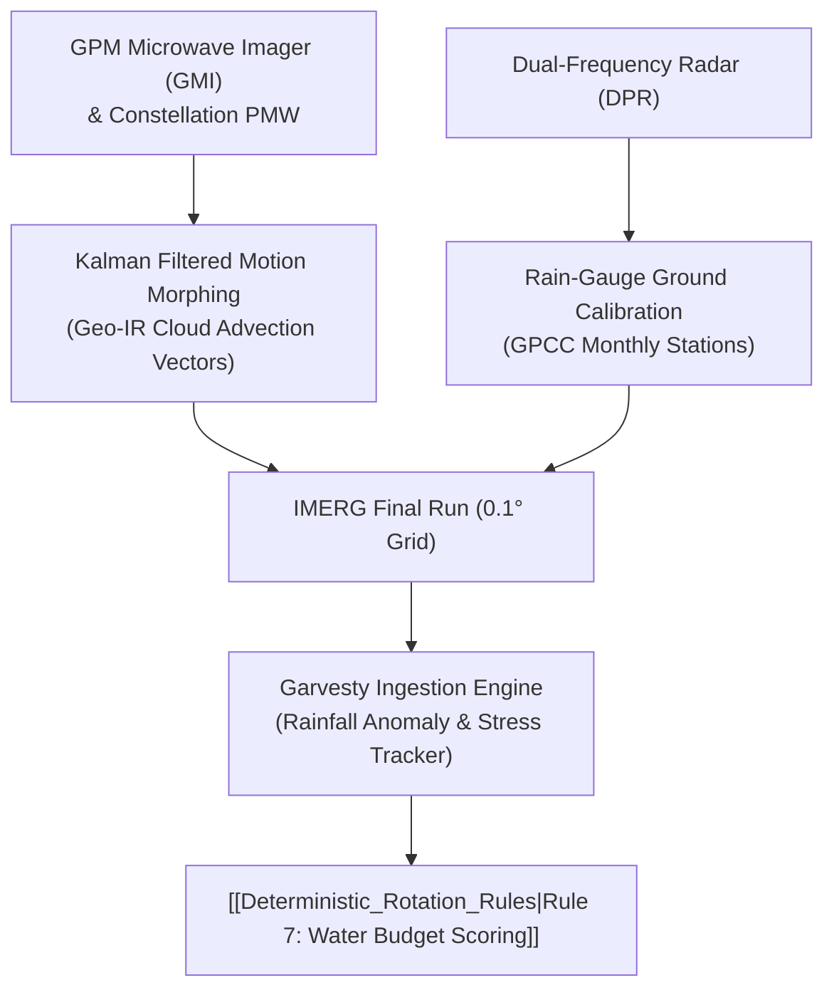

# 🌧️ GPM IMERG High-Resolution Precipitation Telemetry

> [!INFO] NASA GPM IMERG Specifications
> - **Mission**: Global Precipitation Measurement (GPM) Core Observatory + international satellite constellation.
> - **Product**: Integrated Multi-satellitE Retrievals for GPM (IMERG) Final Run (v06 / v07).
> - **Spatial Resolution**: $0.1^\circ \times 0.1^\circ$ ($\approx 10\text{ km} \times 10\text{ km}$).
> - **Temporal Resolution**: 30-minute half-hourly passes aggregated to daily totals ($\text{mm/day}$).
> - **Sensors Combined**: Dual-frequency Precipitation Radar (DPR), GPM Microwave Imager (GMI), partner passive microwave (PMW) radiometers, and geosynchronous infrared (IR) sensors with motion-vector morphing.

---

## 1. Role in Garvesty's Agro-Hydrology

While NASA POWER provides reliable reanalysis precipitation from MERRA-2 ($0.5^\circ \times 0.625^\circ$), convective rainfall in the tropical Ayeyarwady Delta and Central Dry Zone is highly localized. Squall lines and monsoon monsoon depressions produce intense rainfall cells spanning only $5 - 15\text{ km}$.

GPM IMERG complements NASA POWER by:
1. Providing $5\times$ higher spatial resolution ($0.1^\circ$ vs $0.5^\circ$), resolving local rainshadows across the Bago Yoma ridge.
2. Detecting flash precipitation events causing acute field waterlogging ($> 50\text{ mm/day}$), which triggers anaerobic stress in newly emerged legumes.
3. Supplying historical rainfall intensity distributions for computing extreme return periods.

---

## 2. IMERG Processing Tiers & Latency Trade-Offs

NASA delivers IMERG in three distinct operational pipelines:

| Run Tier | Latency | Algorithms & Inputs | Role in Garvesty Architecture |
|---|---|---|---|
| **Early Run** | $\approx 4\text{ hours}$ | Forward-only morphing, PMW + IR | Near-real-time early warning for extreme flooding |
| **Late Run** | $\approx 14\text{ hours}$ | Bidirectional morphing (forward + backward) | Ingested daily for live forward simulations |
| **Final Run** | $\approx 3.5\text{ months}$ | Monthly GPCC ground gauge calibration | Historical baseline training & climatological distributions |

---

## 3. Mathematical Integration with Soil Water Infiltration

When precipitation $P_{IMERG}$ hits the soil surface, the effective infiltration rate $I_{eff}$ is governed by the Green-Ampt infiltration principle as parameterized in the Garvesty bucket model:

$$I_{eff} = \min\left( P_{IMERG},\, K_{sat} \cdot \left[ 1 + \frac{\psi_f \cdot (\theta_s - \theta_i)}{Z_w} \right] \right)$$

Where:
- $K_{sat}$: Saturated hydraulic conductivity ($\text{mm/hr}$) determined by [[ISRIC_SoilGrids_Edaphic_Layer]].
- $\psi_f$: Suction head at the wetting front ($\text{mm}$).
- $\theta_s - \theta_i$: Moisture deficit between saturation and initial moisture content.
- $Z_w$: Cumulative infiltration wetting depth ($\text{mm}$).

Rainfall exceeding $I_{eff}$ is routed to surface runoff or standing ponding depth in lowland paddy fields, while infiltrated water recharges the soil bucket.

---
*Related Notes:*
- [[NASA_Earth_Observations]] — Overview of satellite layers
- [[NASA_POWER_Meteorology]] — Daily gridded temperature and reanalysis data
- [[Physics_and_Timeseries_Hydrology]] — Bucket infiltration and recession equations
- [[Deterministic_Rotation_Rules]] — Rule 7 Water Budgeting logic
- [[FAO_AquaCrop_Water_Productivity]] — Rainfall water productivity modeling
