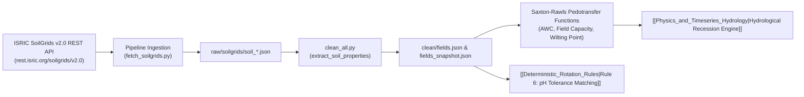

# 🏔️ ISRIC SoilGrids v2.0 Edaphic Layer & Pedotransfer Functions

> [!INFO] Dataset Overview
> - **Provider**: ISRIC – World Soil Information.
> - **Product**: SoilGrids v2.0 (Global Gridded Soil Information at 250m resolution).
> - **Methodology**: Machine learning ensembles (Random Forest & LightGBM) trained on $> 240,000$ standardized profile points from the WoSIS database, driven by $> 400$ environmental covariates (remote sensing, DEM, geology, climate).
> - **Depth Intervals**: $0–5\text{ cm}$, $5–15\text{ cm}$, $15–30\text{ cm}$, $30–60\text{ cm}$, $60–100\text{ cm}$, $100–200\text{ cm}$.

---

## 1. Parameters Ingested by Garvesty

The Garvesty pipeline queries the topsoil interval ($0–5\text{ cm}$) and upper subsoil ($5–15\text{ cm}$) for field coordinates across Myanmar:

| Parameter | Description | Native Storage Unit | Scaled Field Unit | Valid Agronomic Range |
|---|---|---|---|---|
| `phh2o` | Soil pH in 1:5 $\text{H}_2\text{O}$ solution | $\text{pH} \times 10$ | $\text{pH}$ standard | $[3.0,\, 10.0]$ |
| `clay` | Clay fraction (particles $< 0.002\text{ mm}$) | $\text{g/kg}$ | $\text{wt}\%$ ($0 - 100$) | Heavy delta soils: $40 - 65\%$ |
| `silt` | Silt fraction ($0.002 - 0.05\text{ mm}$) | $\text{g/kg}$ | $\text{wt}\%$ ($0 - 100$) | Delta river levees: $30 - 50\%$ |
| `sand` | Sand fraction ($0.05 - 2.0\text{ mm}$) | $\text{g/kg}$ | $\text{wt}\%$ ($0 - 100$) | Dry Zone: $40 - 75\%$ |
| `soc` | Soil Organic Carbon | $\text{dg/kg}$ | $\text{wt}\%$ ($0 - 10\%$) | $0.5 - 2.5\%$ typical |
| `bdod` | Bulk Density of fine earth fraction | $\text{cg/cm}^3$ | $\text{g/cm}^3$ | $1.10 - 1.65\text{ g/cm}^3$ |
| `cec` | Cation Exchange Capacity at pH 7.0 | $\text{mmol(c)/kg}$ | $\text{cmol(c)/kg}$ | Nutrient retention buffer |

---

## 2. Saxton-Rawls Pedotransfer Formulation

Soil texture percentages are translated into physical hydrological parameters using the Saxton and Rawls (2006) pedotransfer equations implemented in [`timeseries_hybrid.py`](file:///C:/Users/ASUS/Downloads/NASA/backend/app/engine/timeseries_hybrid.py):

### Permanent Wilting Point ($\theta_{wp}$)
$$\theta_{wp} = \theta_{1500t} + (0.14 \cdot \theta_{1500t} - 0.02)$$
$$\theta_{1500t} = -0.024 S + 0.487 C + 0.006 OM + 0.005 (S \times OM) - 0.013 (C \times OM) + 0.068 (S \times C) + 0.031$$

### Field Capacity ($\theta_{fc}$)
$$\theta_{fc} = \theta_{33t} + (1.283 \cdot \theta_{33t}^2 - 0.374 \cdot \theta_{33t} - 0.015)$$
$$\theta_{33t} = -0.251 S + 0.195 C + 0.011 OM + 0.006 (S \times OM) - 0.027 (C \times OM) + 0.452 (S \times C) + 0.299$$

### Total Available Water Capacity (TAW)
$$\text{TAW} = (\theta_{fc} - \theta_{wp}) \cdot Z_r \cdot 1000 \quad (\text{mm})$$
Where:
- $S$: Sand fraction ($0 - 1$).
- $C$: Clay fraction ($0 - 1$).
- $OM$: Organic matter fraction ($OM = 1.724 \times SOC$).
- $Z_r$: Effective rooting depth ($0.6\text{ m}$).

### Characteristic Drainage Recession Time Constant ($\tau$)
As documented in the bucket model:
- **Heavy Clay** (Ayeyarwady Delta Vertisols): $\tau \approx 45\text{ days}$, $\text{TAW} \approx 180\text{ mm/m}$.
- **Clay Loam**: $\tau \approx 35\text{ days}$, $\text{TAW} \approx 175\text{ mm/m}$.
- **Loam / Silt Loam**: $\tau \approx 28\text{ days}$, $\text{TAW} \approx 150\text{ mm/m}$.
- **Sandy Loam** (Central Dry Zone): $\tau \approx 18\text{ days}$, $\text{TAW} \approx 110\text{ mm/m}$.
- **Sand**: $\tau \approx 10\text{ days}$, $\text{TAW} \approx 60\text{ mm/m}$.

---

## 3. Coupling with FAO EcoCrop pH Tolerances

Topsoil `phh2o` directly forces [[Deterministic_Rotation_Rules|Rule 6]]:
- Optimal pH range ($pH_{opmin} \le pH \le pH_{opmax}$): **+15 points**
- Absolute tolerance range ($pH_{min} \le pH \le pH_{max}$): **+0 points** (neutral)
- Beyond absolute range: Hard disqualification or severe penalty (**-30 points**), preventing acid-sensitive crops (such as chickpea) from being recommended in acidic delta soils ($pH < 5.0$).

---
*Related Notes:*
- [[NASA_Earth_Observations]] — Overview of geospatial data layers
- [[Physics_and_Timeseries_Hydrology]] — Soil bucket dynamics and recession
- [[Deterministic_Rotation_Rules]] — Rule 6 soil pH matching
- [[FAO_EcoCrop_Agronomic_Limits]] — Comprehensive crop tolerance database
- [[Myanmar_Delta_and_Dry_Zone_Crops]] — Soil preferences across crops
