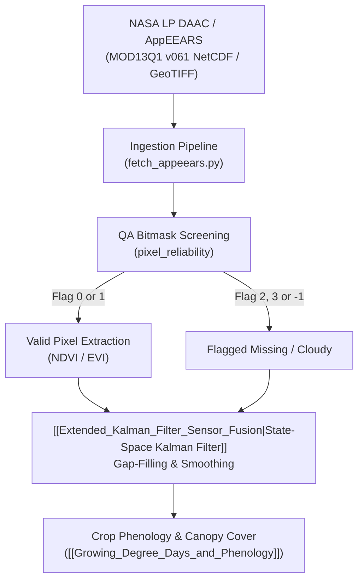

# 🌿 MODIS Terra MOD13Q1 Vegetation Indices & Quality Assurance

> [!INFO] Satellite Instrument Specifications
> - **Platform**: Terra (EOS AM-1), Sun-synchronous orbit, 10:30 AM local equator crossing.
> - **Product**: `MOD13Q1.061` (Vegetation Indices 16-Day L3 Global 250m SIN Grid).
> - **Spatial Resolution**: $250\text{ meters} \times 250\text{ meters}$.
> - **Temporal Resolution**: 16-day compositing window using the Constrained View Angle-Maximum Value Composite (CV-MVC) technique.

---

## 1. Key Vegetation Bands & Physical Formulations

### Normalized Difference Vegetation Index (NDVI)
$$NDVI = \frac{\rho_{NIR} - \rho_{RED}}{\rho_{NIR} + \rho_{RED}}$$
Where:
- $\rho_{NIR}$: Surface reflectance in Band 2 ($841 - 876\text{ nm}$).
- $\rho_{RED}$: Surface reflectance in Band 1 ($620 - 670\text{ nm}$).
- **Physical Range**: $[-0.2, 1.0]$. Values $< 0.1$ represent water, flooded paddy, or bare soil. Values $> 0.6$ represent peak vegetative canopy (heading stage of monsoon rice).

### Enhanced Vegetation Index (EVI)
In dense tropical canopies (e.g. wet-season delta rice paddies), NDVI saturates due to high leaf area index ($LAI > 3$). EVI incorporates the blue band to correct for canopy background signals and atmospheric aerosol scattering:
$$EVI = 2.5 \cdot \frac{\rho_{NIR} - \rho_{RED}}{\rho_{NIR} + 6 \cdot \rho_{RED} - 7.5 \cdot \rho_{BLUE} + 1}$$
Where $\rho_{BLUE}$ is Band 3 ($459 - 479\text{ nm}$).

---

## 2. Quality Assurance (QA) Bitmask Screening

> [!WARNING] The Monsoon Optical Blindness Trap
> During the Southwest Monsoon (June–September), optical sensors over Myanmar suffer from continuous cloud obstruction. Treating unmasked cloudy pixels or zero-imputed missing values as crop death corrupts vegetative models.

In [`clean_all.py`](file:///C:/Users/ASUS/Downloads/NASA/pipeline/clean_all.py), strict bitmask quality screening is enforced:

| `pixel_reliability` Flag | Meaning | Pipeline Action | Agronomic Handling |
|---|---|---|---|
| `0` | Good data; use with confidence | **Retained** | Direct ingestion into phenology tracker |
| `1` | Marginal data; useful | **Retained** | Weighted with lower precision in Kalman filter |
| `2` | Snow / Ice | **Rejected** | Filtered to `NaN` |
| `3` | Cloudy | **Rejected** | Replaced by microwave SMAP or Kalman prediction |
| `-1` | Fill / No data | **Rejected** | Filtered to `NaN` |

Furthermore, raw values stored as signed 16-bit integers must be multiplied by the scale factor:
$$\text{NDVI}_{scaled} = \text{Raw} \times 0.0001$$
Any scaled values outside $[-0.2, 1.0]$ are immediately flagged as sensor artifacts and scrubbed.

---

## 3. Data Integration with Crop Phenology

Filtered NDVI trajectories track the 4 critical developmental phases of Myanmar crops:
1. **Paddy Flooding / Transference** (May–June): Rapid drop in NDVI to near 0.0 or negative values indicating specular reflection from standing water.
2. **Vegetative Tillering** (July–August): Steep exponential increase in NDVI ($0.2 \to 0.75$).
3. **Heading / Grain Filling** (September–October): Peak NDVI plateau ($0.75 - 0.85$).
4. **Maturity / Drainage** (October–November): Rapid dry-down and senescent decline ($0.85 \to 0.35$), signaling the exact post-monsoon legume planting window.

---
*Related Notes:*
- [[NASA_Earth_Observations]] — Overview of spaceborne data layers
- [[Extended_Kalman_Filter_Sensor_Fusion]] — Fusing intermittent optical NDVI with continuous weather
- [[Remote_Sensing_Quality_Flags_and_Masking]] — Automated bitmask decoding protocols
- [[FAO_AquaCrop_Water_Productivity]] — Translating NDVI/EVI into Green Canopy Cover ($CC$)
- [[Myanmar_Delta_and_Dry_Zone_Crops]] — Phenological timelines for Delta and Dry Zone species
