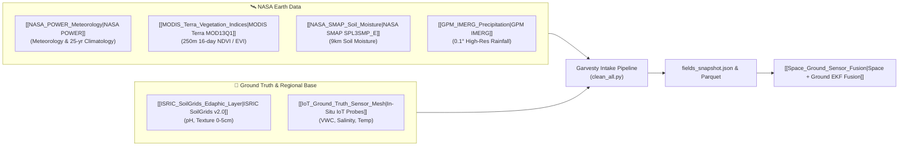

# 🛰️ NASA Earth Observations & SoilGrids Data Layer

> [!INFO] Ground Resolution vs Field Reality
> NASA satellites provide regional observation grids ($0.5^\circ$ for POWER, $9\text{ km}$ for SMAP, $0.1^\circ$ for IMERG, $250\text{ m}$ for MODIS). They reflect regional climate and vegetation trends, not individual farm-plot boundaries. Local soil pH and in-situ IoT probes ground the satellite data into field reality.

---

## 1. Primary Datasets in the Garvesty Vault

- 🌦️ **[[NASA_POWER_Meteorology]]**: 25-year daily reanalysis climatology (MERRA-2 / GEOS), solar irradiance, $T_{2M}$, and 5-day embargo management.
- 🌿 **[[MODIS_Terra_Vegetation_Indices]]**: 250m 16-day composite NDVI and EVI, pixel reliability QA bitmask screening, and cloud mask inversion avoidance.
- 💧 **[[NASA_SMAP_Soil_Moisture]]**: 9km passive L-band microwave radiometry, penetrating monsoonal clouds to track topsoil volumetric moisture and paddy drainage.
- 🌧️ **[[GPM_IMERG_Precipitation]]**: 0.1° half-hourly satellite precipitation constellation, multi-satellite morphing, and localized squall line detection.
- 🏔️ **[[ISRIC_SoilGrids_Edaphic_Layer]]**: 250m global topsoil map providing pH, clay/silt/sand fractions, soil organic carbon, and Saxton-Rawls pedotransfer parameters.

---

## 2. Ingestion Pipeline Architecture (`pipeline/clean_all.py`)

All raw satellite telemetry enters via dedicated API scrapers:
- [`pipeline/fetch_power.py`](file:///C:/Users/ASUS/Downloads/NASA/pipeline/fetch_power.py) $\to$ `raw/power/daily_*.json`
- [`pipeline/fetch_appeears.py`](file:///C:/Users/ASUS/Downloads/NASA/pipeline/fetch_appeears.py) $\to$ `raw/modis/`
- [`pipeline/fetch_soilgrids.py`](file:///C:/Users/ASUS/Downloads/NASA/pipeline/fetch_soilgrids.py) $\to$ `raw/soilgrids/`

The deterministic normalization script [`clean_all.py`](file:///C:/Users/ASUS/Downloads/NASA/pipeline/clean_all.py) applies:
1. **SHA-256 Checksums**: Verifies provenance on every raw file.
2. **Missing / Fill-Value Scrubbing**: Flags `-999.0` and unphysical values.
3. **Parquet Export**: Converts time series into Snappy-compressed Apache Parquet tables for zero-copy querying.
4. **Data Hygiene Auditing**: Generates `reports/cleaning_report.json` tracking dropped rows, date ranges, and quality distributions (see [[Data_Autocleaning_and_Dataplex_Profiling]]).

---

## 3. Data Tier Badging & Provenance Schema

To prevent misleading farmers or judges:
- **`LIVE`**: Telemetry fetched from near-real-time satellite APIs within the last 48 hours.
- **`CACHED`**: Historical archived satellite telemetry validated by offline checksums.
- **`REGIONAL_GRID_ESTIMATE`**: Coarse $9\text{ km} - 55\text{ km}$ satellite cells clearly badged in the UI.
- **`GROUND_TRUTH`**: Local in-situ capacitive FDR probe telemetry overriding regional satellite biases.

---
*Related Notes:*
- [[Garvesty_Hub]] — Master Map of Content
- [[Physics_and_Timeseries_Hydrology]] — Physics-informed hydrology engine
- [[Space_Ground_Sensor_Fusion]] — State-space EKF sensor fusion
- [[Remote_Sensing_Quality_Flags_and_Masking]] — Bitmask parsing protocols
- [[BigQuery_Time_Series_Pipelines]] — Cloud-scale data warehousing
