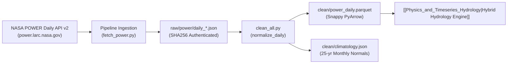

# 🌦️ NASA POWER Meteorological Data Pipeline & Climatology

> [!INFO] NASA POWER Ingestion Contract
> - **Product**: NASA Prediction Of Worldwide Energy Resources (POWER) Daily API v2, Community AG.
> - **Model Base**: MERRA-2 (Modern-Era Retrospective analysis for Research and Applications, Version 2) and GEOS-5 FP-IT reanalysis.
> - **Spatial Resolution**: $0.5^\circ \text{ latitude} \times 0.625^\circ \text{ longitude}$ ($\approx 55 \times 67\text{ km}$ at tropical latitudes).
> - **Latency Embargo**: Historical stream is finalized on a $3 - 5\text{ day}$ latency; near-real-time (NRT) feeds fill the trailing window.

---

## 1. Primary Meteorological Parameters

The Garvesty data pipeline ingests 6 core daily parameters per coordinate cell:

| Parameter Code | Description | Physical Units | Processing & Validation Range |
|---|---|---|---|
| `T2M` | Daily Mean Temperature at 2m | $^\circ\text{C}$ | Screened: $-10.0 \le T_{2M} \le 50.0$ |
| `T2M_MAX` | Daily Maximum Temperature at 2m | $^\circ\text{C}$ | Required for [[Growing_Degree_Days_and_Phenology\|GDD]] & Hargreaves PET |
| `T2M_MIN` | Daily Minimum Temperature at 2m | $^\circ\text{C}$ | Diurnal range constraint: $T_{MAX} \ge T_{MIN}$ |
| `PRECTOTCORR` | Corrected Total Daily Precipitation | $\text{mm/day}$ | Physical bound: $0.0 \le P \le 600.0\text{ mm}$ |
| `GWETROOT` | Root-Zone Soil Wetness Fraction | Dimensionless $[0, 1]$ | Modeled 0–1m root zone wetness fraction |
| `GWETTOP` | Surface Soil Wetness Fraction | Dimensionless $[0, 1]$ | Modeled 0–5cm topsoil wetness fraction |
| `ALLSKY_SFC_SW_DWN` | All-Sky Surface Shortwave Solar Irradiance | $\text{MJ/m}^2/\text{day}$ | Informs Penman-Monteith & [[FAO_AquaCrop_Water_Productivity\|AquaCrop]] |

---

## 2. Temporal Processing & Derived Features

In [`clean_all.py`](file:///C:/Users/ASUS/Downloads/NASA/pipeline/clean_all.py), daily records are cleaned, deduplicated, and enriched with temporal rolling features without lookahead bias:

### A. Growing Degree Days (GDD)
Accumulated thermal time above base threshold $T_{base} = 10^\circ\text{C}$:
$$\text{GDD}_{10} = \max\left(0,\, \frac{T_{MAX} + T_{MIN}}{2} - 10\right)$$
See [[Growing_Degree_Days_and_Phenology]] for pulse-specific phenological triggers.

### B. Rolling Precipitation Accumulations
- `rain_7d`: 7-day backward moving sum:
  $$\text{rain\_7d}(t) = \sum_{i=0}^{6} \text{PRECTOTCORR}(t - i)$$
- `rain_30d`: 30-day backward moving sum reflecting sub-seasonal drought vs. waterlogging regimes.

---

## 3. Climatological Baseline vs. Live Trailing Anomaly

To overcome the **Stationarity Fallacy** (see [[ML_Best_Practices_for_Agriculture]]), Garvesty computes 25-year monthly climatologies (2001–2025 normals) for:
- Mean monthly rainfall ($\text{mm/month}$)
- Monthly mean temperature and diurnal amplitude ($\Delta T = T_{MAX} - T_{MIN}$)
- Typical monsoon onset (May 15–June 5) and withdrawal (October 15–November 5) dates in the Ayeyarwady Delta.

Live telemetry is cross-referenced with climatology to generate trailing 10-day anomalies in [[Workspaces_F1_to_A4|Analyst Workspace A1]], signaling delayed monsoon recessions or early desaturations.

---

## 4. Latency Handling & Embargo Architecture

> [!WARNING] Avoiding Future Lookahead Leakage
> Because NASA POWER has a 3–5 day lag in finalizing MERRA-2 meteorological assimilation, real-time pipelines cannot assume day $t-1$ is present.
> 
> As implemented in [`evaluate_models.py`](file:///C:/Users/ASUS/Downloads/NASA/pipeline/evaluate_models.py):
> - **Feature Window**: 28 consecutive days ending at $t_{issue} - 5\text{ days}$.
> - **Availability Lag**: 5-day embargo period $[t_{issue} - 4,\, t_{issue}]$.
> - **Target Window**: 7-day forward horizon starting at $t_{issue} + 1\text{ day}$.

This strict chronological isolation ensures models are evaluated under authentic real-world deployment conditions. See [[Time_Series_Cross_Validation_and_Purging]] for algorithmic details.

---
*Related Notes:*
- [[NASA_Earth_Observations]] — Overview of all spaceborne products
- [[Physics_and_Timeseries_Hydrology]] — Penman-Monteith PET and bucket recession
- [[ISRIC_SoilGrids_Edaphic_Layer]] — Edaphic soil capacity fusion
- [[Conformal_Prediction_Calibration]] — 90% confidence interval calibration
- [[BigQuery_Time_Series_Pipelines]] — Scaling POWER ingestion to BigQuery
