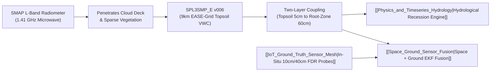

# 💧 NASA SMAP L3 Radiometer Soil Moisture & Spatial Scaling

> [!INFO] NASA SMAP Mission Specifications
> - **Product**: `SPL3SMP_E.006` (SMAP Enhanced L3 Radiometer Global Daily 9 km EASE-Grid Soil Moisture).
> - **Instrument**: L-band passive radiometer ($1.41\text{ GHz}$, wavelength $\lambda \approx 21\text{ cm}$).
> - **Spatial Resolution**: $9\text{ km} \times 9\text{ km}$ posted on the equal-area scalable Earth grid (EASE-Grid 2.0).
> - **Penetration Depth**: Top $0 - 5\text{ cm}$ of the soil profile.
> - **Revisit Orbit**: Sun-synchronous 6:00 AM (descending) and 6:00 PM (ascending) passes, with 2–3 day global repeat cycle.

---

## 1. Physical Significance in Tropical Deltas

Unlike optical sensors (MODIS, Sentinel-2) which are completely obscured by monsoonal cloud decks, L-band microwave radiometry ($1.41\text{ GHz}$) penetrates through clouds, haze, and rain.

SMAP provides the single most reliable spaceborne signal for:
1. **Monsoon Drainage Detection**: Pinpointing the exact date floodwaters drain from delta rice paddies.
2. **Post-Monsoon Soil Moisture Recession**: Measuring the rapid topsoil dry-down that dictates pulse seed germination success.

---

## 2. Ingestion Variables & Quality Filtering

In the Garvesty backend ([`pipeline/clean_all.py`](file:///C:/Users/ASUS/Downloads/NASA/pipeline/clean_all.py) and [`backend/app/services/data.py`](file:///C:/Users/ASUS/Downloads/NASA/backend/app/services/data.py)):

| Field Name | Variable Description | Units | Physical Valid Bounds |
|---|---|---|---|
| `soil_moisture` | Morning pass (6:00 AM) volumetric water content | $\text{cm}^3/\text{cm}^3$ | $[0.00,\, 0.60]$ |
| `soil_moisture_pm` | Evening pass (6:00 PM) volumetric water content | $\text{cm}^3/\text{cm}^3$ | $[0.00,\, 0.60]$ |
| `retrieval_qual_flag` | Data quality bitmask | Integer | Only flags `0` (Recommended) and `8` accepted |
| `surface_flag` | Surface condition flag | Bitmask | Rejects standing water, ice, dense urban cover |

Values exceeding soil porosity ($\approx 0.60\text{ cm}^3/\text{cm}^3$ in Delta clays) or negative values are discarded.

---

## 3. Topsoil-to-Rootzone Scaling Dynamics

SMAP measures only the top $0 - 5\text{ cm}$ of the soil profile. However, agricultural crops (black gram, chickpea, monsoon rice) draw water from the active root-zone ($0 - 60\text{ cm}$ or deeper).

Garvesty connects SMAP surface observations $S_{top}$ to the root-zone $S_{root}$ via a coupled two-layer diffusion equation:

$$\frac{d S_{root}}{dt} = \frac{D_{eff}}{z_{root}} \left( S_{top} - S_{root} \right) - \frac{ET_c}{TAW_{root}}$$

Where:
- $D_{eff}$: Effective hydraulic diffusivity between topsoil and subsoil ($\text{m}^2/\text{day}$).
- $z_{root}$: Root-zone depth ($0.6\text{ m}$ for mature pulses).
- $ET_c$: Crop evapotranspiration from [[Physics_and_Timeseries_Hydrology]].
- $TAW_{root}$: Total available water capacity from [[ISRIC_SoilGrids_Edaphic_Layer]].

When in-situ ground sensors are available, the [[Space_Ground_Sensor_Fusion|Extended Kalman Filter]] uses 40cm probe telemetry to ground-truth and calibrate this two-layer model.

---
*Related Notes:*
- [[NASA_Earth_Observations]] — Overview of Earth observation assets
- [[Space_Ground_Sensor_Fusion]] — Merging 9km SMAP cells with in-situ plot sensors
- [[IoT_Ground_Truth_Sensor_Mesh]] — Dual-depth in-situ probes (10cm & 40cm VWC)
- [[Physics_and_Timeseries_Hydrology]] — Soil water balance kinetics
- [[ISRIC_SoilGrids_Edaphic_Layer]] — Soil texture and hydraulic conductivity parameters
