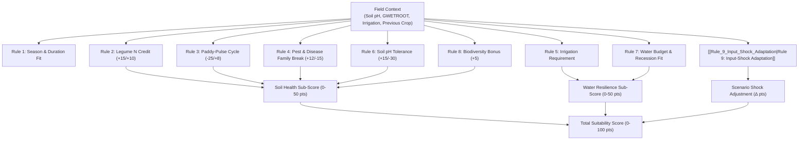

# ⚖️ Deterministic Crop Rotation Rules & Scoring Engine (Rules 1–8)

> [!NOTE] Design Principle: Deterministic vs. Black-Box Hallucination
> Rather than using stochastic generative LLMs that invent arbitrary farming advice, Garvesty calculates rotation suitability scores using pure, auditable deterministic functions implemented in [`backend/app/engine/rules.py`](file:///C:/Users/ASUS/Downloads/NASA/backend/app/engine/rules.py).
> 
> Total Score = **Soil Health (50 pts)** + **Water Stress Resilience (50 pts)** + **Scenario Adjustment ($\pm \Delta$)**.

---

## 1. Rule 1: Seasonal Slot & Duration Fit (`rule_season_fit`)
- **Objective**: Guarantees a crop physically fits the astronomical and climatic window of the planned slot.
- **Seasons**:
  - `monsoon`: May to October ($184\text{ days}$).
  - `dry`: November to April ($181\text{ days}$).
- **Logic**:
  - Checks if `slot in crop.slots`.
  - Verifies minimum maturity duration: `crop.duration_days[0] <= SLOTS[slot]["days"]`.
  - If invalid, returns a fatal rejection reason, eliminating the permutation from candidate recommendations.

---

## 2. Rule 2: Biological Legume Nitrogen Credit (`rule_legume_credit`)
- **Objective**: Rewards biological nitrogen fixation ($N_2$) that replenishes exhausted paddy soil nitrogen pools without synthetic urea.
- **Scoring**:
  - Dry-season legume (black gram, chickpea, groundnut, green gram): **+15 points** to `soil`.
  - Monsoon legume (pigeon pea, green gram): **+10 points** to `soil`.
- **Scientific Rationale**: Delta legumes inoculated with *Bradyrhizobium* fix between $40 - 120\text{ kg N/ha}$, reducing synthetic nitrogen requirement for the subsequent monsoon paddy (see [[Biological_Nitrogen_Fixation_and_Residues]]).

---

## 3. Rule 3: Paddy-Pulse Cycle Dynamics (`rule_paddy_cycle`)
- **Objective**: Models the specific agronomic symbiosis of the Myanmar Delta paddy-pulse cropping system.
- **Scoring**:
  - **Back-to-Back Flooded Rice Penalty**: If dry crop is flooded summer rice and either previous crop or upcoming monsoon crop is flooded rice: **-25 points** to `soil`. Prevents soil structure degradation, hardpan formation, and continuous stem borer build-up.
  - **Rice $\to$ Pulse Credit**: Previous crop flooded rice followed immediately by black gram or green gram: **+8 points** to `soil`.
  - **Fallow Rest Credit**: Dry fallow between two consecutive rice crops: **+6 points** to `soil`.

---

## 4. Rule 4: Pest & Disease Family Break (`rule_pest_break`)
- **Objective**: Suppresses soil-borne pathogens, nematodes, and host-specific insect complexes.
- **Scoring**:
  - **Same-Family Repeat Penalty**: Growing identical botanical families sequentially (e.g. Poaceae $\to$ Poaceae like Rice $\to$ Maize): **-15 points** to `soil`.
  - **Cross-Family Rotation Reward**: True botanical family break (e.g. Poaceae $\to$ Fabaceae or Pedaliaceae): **+12 points** to `soil`.

---

## 5. Rule 5: Dry-Season Irrigation Feasibility (`rule_irrigation_required`)
- **Objective**: Prevents recommending high-water crops to water-insecure smallholders.
- **Logic**:
  - If slot is `dry` and `crop.needs_irrigation_in_dry` is `True` (e.g. Summer Rice), and the field is marked as `irrigated = False` (rainfed):
  - **Immediate Rejection**: Crop is blocked with message: *"Needs irrigation through the dry season; this field is marked rain-fed."*

---

## 6. Rule 6: Soil pH Tolerance Matching (`rule_ph_tolerance`)
- **Objective**: Evaluates edaphic chemistry using [[ISRIC_SoilGrids_Edaphic_Layer]] topsoil pH against [[FAO_EcoCrop_Agronomic_Limits]].
- **Scoring**:
  - **Optimal Range** ($pH_{opmin} \le pH \le pH_{opmax}$): **+15 points** to `soil`.
  - **Marginal Absolute Range** ($pH_{min} \le pH \le pH_{max}$): **+0 points** (neutral).
  - **Outside Absolute Range**: **-30 points** to `soil`, warning of severe aluminum/iron toxicity ($pH < 4.5$) or micronutrient lockup ($pH > 8.5$).

---

## 7. Rule 7: Water Budget & Recession Adequacy (`rule_water_budget`)
- **Objective**: Matches crop evapotranspiration demand against root-zone soil wetness (`GWETROOT` from [[NASA_POWER_Meteorology]]) and projected recession.
- **Baseline Water Points** (`WATER_POINTS`):
  - `very_high` (Summer Rice): **0 pts**
  - `medium` (Maize, Groundnut): **50 pts**
  - `low_medium` (Pigeon pea): **65 pts**
  - `low` (Black gram, Green gram, Sesame, Chickpea): **80 pts**
  - `none` (Fallow): **100 pts**
- **Dynamic Adjustments**:
  - If dry season `GWETROOT < 0.40` and crop is low-water pulse: rewards fast-maturing pulse with **+10 points** to `water`.
  - If dry season `GWETROOT < 0.25`: severe desaturation penalty applied unless irrigated.

---

## 8. Rule 8: Agrobiodiversity Score (`rule_diversity`)
- **Objective**: Rewards farm-level resilience against monoculture vulnerabilities.
- **Scoring**:
  - Adding a distinct second crop to a continuous monoculture regime: **+5 points** to `soil`.

---
*Related Notes:*
- [[Rule_9_Input_Shock_Adaptation]] — The supply-chain crisis adaptation engine
- [[FAO_EcoCrop_Agronomic_Limits]] — Botanical tolerance thresholds
- [[Myanmar_Delta_and_Dry_Zone_Crops]] — Taxonomy of Myanmar crops
- [[Biological_Nitrogen_Fixation_and_Residues]] — Legume nitrogen credit mechanics
- [[Physics_and_Timeseries_Hydrology]] — Hydrological recession backing Rule 7
