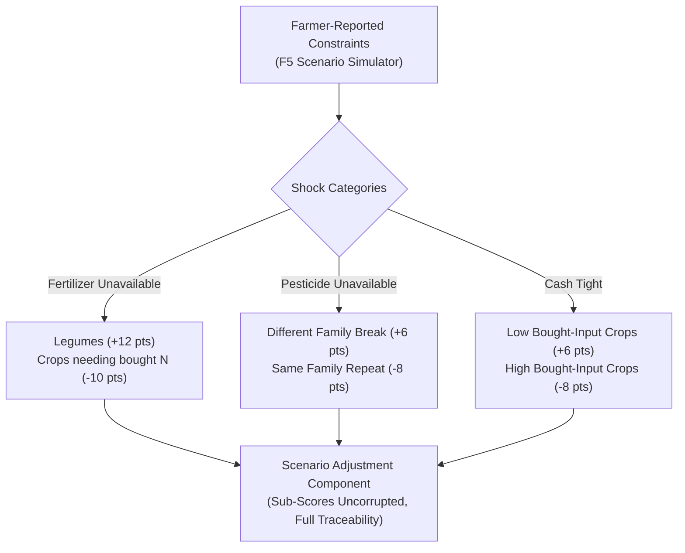

# ⚖️ Rule 9: Input-Shock Adaptation Engine

> [!NOTE] Hackathon Scoring Advantage
> Farmers already know standard baseline rotations. The real value of an autonomous decision-support system is **resilience when the plan breaks**: supply chain disruption, sudden chemical shortages, price spikes, or acute financial constraints.

---

## 1. Input Cost Tiers (`crops.py`)
Each crop has a relative bought-input cost tier reflecting reliance on synthetic nitrogen, chemical pest control, and pumped irrigation:
- **`none`**: Fallow / green manure.
- **`low`**: Legumes (black gram, green gram, chickpea, groundnut, pigeon pea) that fix biological nitrogen; sesame.
- **`medium`**: Maize (needs moderate N and weed control).
- **`high`**: Monsoon rice & summer rice (heavy bought urea/DAP, pesticide, water management).

---

## 2. Rule Logic and Delta Adjustments (`rules.py`)

### A. Synthetic Fertilizer Disruption
- **`unavailable`**:
  - Legumes receive **+12 points** (biological nitrogen fixation cushions the shortage).
  - High-input crops (rice) receive **-10 points** (yield drops drastically without synthetic N).
- **`expensive`**:
  - Legumes receive **+8 points**.
  - High-input crops receive **-6 points**.

### B. Pesticide Unavailability
- The crop rotation itself must serve as biological pest suppression:
  - Sequences with a **crop-family break** receive **+6 points**.
  - Sequences repeating the same family without interruption receive **-8 points** (elevated carry-over pest risk).

### C. Cash Tightness
- Low bought-input crops receive **+6 points**.
- High bought-input crops receive **-8 points**.

---

## 3. Structural Integrity Guarantee
- Adjustments are applied strictly to the `adjustment` score component.
- The underlying physical `soil` and `water` sub-scores remain pure and uncorrupted.
- Every adjustment carries an explicit **"farmer-reported"** audit reason in the JSON and UI breakdown.
- The farmer's existing rotation is **never hidden**, even under severe multi-variable shocks.

---
*Back to: [[Garvesty_Hub]]*
