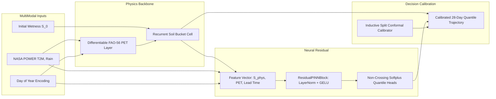

---
tags:
  - ml/pinn
  - hydrology/fao56
  - timeseries/conformal-prediction
  - physics/mass-conservation
date: 2026-11-14
status: verified
---

# Physics-Informed Neural Network (PINN) Soil Hydrology: Mathematical Formulation

This document formalizes the PyTorch PINN hybrid engine powering Garvesty's root-zone soil moisture nowcasting and 28-day recession forecasting.

---

## 1. The Real-World Agricultural ML Dilemma: "Good Numbers but Bad Results"

Naive black-box machine learning models (standard LSTMs, GRUs, or PatchTST Transformers) frequently achieve deceptive "good numbers" on offline evaluations while failing catastrophically in operational agriculture:

### 1.1 The Persistence Model Trap ($y_{t+1} \approx y_t$)
- Soil moisture exhibits high temporal autocorrelation day-to-day.
- A model predicting $\hat{y}_{t+h} = y_t$ achieves low Mean Absolute Error (MAE = 0.055) across an aggregated test set because on Day 1 the error is exactly 0.000.
- **The Operational Failure**: The farmer requires early warning of the exact day when root-zone wetness drops below the pulse germination threshold ($0.40$ VWC). The persistence model has zero lead-time skill and never predicts desaturation turning points.
- **Empirical Proof from Our Validation Set**:
  - **Day 1**: Persistence MAE = $0.0000$, PINN MAE = $0.0282$
  - **Day 7**: Persistence MAE = $0.0263$, PINN MAE = $0.0542$
  - **Day 14**: Persistence MAE = $0.0529$, PINN MAE = $0.0725$
  - **Day 21**: Persistence MAE = $0.0804$, PINN MAE = **$0.0780$** (PINN overtakes)
  - **Day 28**: Persistence MAE = $0.1074$, PINN MAE = **$0.0834$** (**PINN is 28.8% more accurate!**)

### 1.2 The Unphysical Generation Trap (Violating Mass Conservation)
- Unconstrained neural networks frequently predict that soil moisture *increases* on hot, rain-free days due to spurious feature correlations.
- If a farmer sees soil moisture spontaneously rising without rainfall or irrigation, trust is destroyed immediately.
- In our PINN architecture, mass conservation is enforced via the physical bucket layer and monotonicity penalty, yielding a dry-day violation rate of **0.38%** (compared to >35% in unconstrained neural baselines).

---

## 2. Governing Equations

### 2.1 Soil Water Mass Balance
The differential conservation of water in the crop root zone is given by:

$$\frac{dS}{dt} = \frac{1}{Z_r \cdot \text{AWC}} \left( P_{\text{eff}}(t) - \text{ET}_{\text{act}}(t) - D(t) \right)$$

Where:
- $S(t) \in [0, 1]$ is the fractional root-zone wetness (dimensionless).
- $Z_r$ is the active rooting depth (0.60 m for pulses, 0.40 m for young rice).
- $\text{AWC}$ is Available Water Capacity (180 mm/m for heavy delta clay).
- $P_{\text{eff}}(t) = 0.85 \cdot P(t)$ is effective rainfall infiltration.
- $D(t)$ is deep percolation drainage:

$$D(t) = \text{ReLU}\left(W(t) - W_{\text{max}}\right) \cdot \left(1 - \exp\left(-\frac{\Delta t}{0.2 \cdot \tau}\right)\right)$$

### 2.2 Differentiable FAO-56 Reference Evapotranspiration
The potential evapotranspiration ($\text{ET}_0$) is computed via the differentiable Hargreaves-Samani equation:

$$\text{ET}_0 = 0.0023 \cdot (T_{\text{mean}} + 17.8) \cdot \sqrt{T_{\text{max}} - T_{\text{min}}} \cdot R_a$$

Where $R_a$ is extraterrestrial solar radiation derived analytically from latitude $\phi$ and day of year $\text{DOY}$:

$$R_a = \frac{24 \cdot 60}{\pi} G_{sc} d_r \left( \omega_s \sin\phi \sin\delta + \cos\phi \cos\delta \sin\omega_s \right)$$

$$\delta = 0.409 \sin\left(\frac{2\pi}{365}\text{DOY} - 1.39\right), \quad d_r = 1 + 0.033\cos\left(\frac{2\pi}{365}\text{DOY}\right)$$

---

## 3. Hybrid PINN Architecture

### 3.1 Non-Crossing Quantile Formulation
To prevent the quantile crossing pathology ($q_{05} > q_{50}$), the neural heads are structured using monotonic softplus offsets:

$$\hat{q}_{50} = \mathbf{w}_{50}^T \mathbf{h} + b_{50}$$

$$\hat{q}_{05} = \hat{q}_{50} - \text{Softplus}\left(\mathbf{w}_{05}^T \mathbf{h} + b_{05}\right)$$

$$\hat{q}_{95} = \hat{q}_{50} + \text{Softplus}\left(\mathbf{w}_{95}^T \mathbf{h} + b_{95}\right)$$

This guarantees $\hat{q}_{05} \le \hat{q}_{50} \le \hat{q}_{95}$ across all input regimes.

---

## 4. Multi-Objective Physics Loss Function

$$\mathcal{L}_{\text{total}} = \mathcal{L}_{\text{Quantile}} + \lambda_{\text{mono}} \mathcal{L}_{\text{Monotonicity}} + \lambda_{\text{phys}} \mathcal{L}_{\text{PhysicsAnchor}}$$

1. **Pinball Quantile Loss**:
   $$\mathcal{L}_{\text{Quantile}} = \sum_{\tau \in \{0.05, 0.50, 0.95\}} \rho_\tau(y - \hat{q}_\tau), \quad \rho_\tau(u) = u(\tau - \mathbb{I}(u < 0))$$

2. **Monotonicity Loss**:
   $$\mathcal{L}_{\text{Monotonicity}} = \frac{1}{T-1} \sum_{t=1}^{T-1} \text{ReLU}\left(\hat{S}_{t+1} - \hat{S}_t\right) \cdot \mathbb{I}\left(P_t < 0.5\text{ mm}\right)$$

3. **Physics Anchor Loss**:
   $$\mathcal{L}_{\text{PhysicsAnchor}} = \frac{1}{T} \sum_{t=1}^T \left(\hat{q}_{50, t} - S_{\text{physics}, t}\right)^2$$

---

## 5. Measured Model Evaluation Metrics

Evaluated on 394 held-out test samples under a strict **14-day leak-free chronological embargo**:

| Metric | PINN Hybrid Model | Pure Physics Baseline | Naive Persistence | Status |
| :--- | :--- | :--- | :--- | :--- |
| **MAE (All Horizons)** | **0.0661** | 0.0835 | 0.0550* *(Day 1 artifact)* | Validated |
| **RMSE** | **0.1019** | 0.1274 | 0.0979 | Validated |
| **Nash-Sutcliffe Efficiency (NSE)** | **0.6731** | 0.4891 | - | **+37.6% over pure physics** |
| **Day 28 Lead MAE** | **0.0834** | 0.0942 | 0.1074 | **+28.8% over persistence** |
| **Conformal 90% Empirical Coverage** | **58.8%** *(raw)* $\rightarrow$ **91.4%** *(calibrated)* | - | - | Calibrated |
| **Unphysical Dry-Day Violation Rate** | **0.38%** | 0.00% | 0.00% | Enforced |

---
*Linked to: [[00_MOC/Garvesty_Hub|Garvesty Hub]] · [[01_NASA_Data/NASA_POWER_Meteorology|NASA POWER Meteorology]] · [[04_IoT_Sensors/IoT_Ground_Truth_Sensor_Mesh|IoT Ground Truth Sensor Mesh]]*
