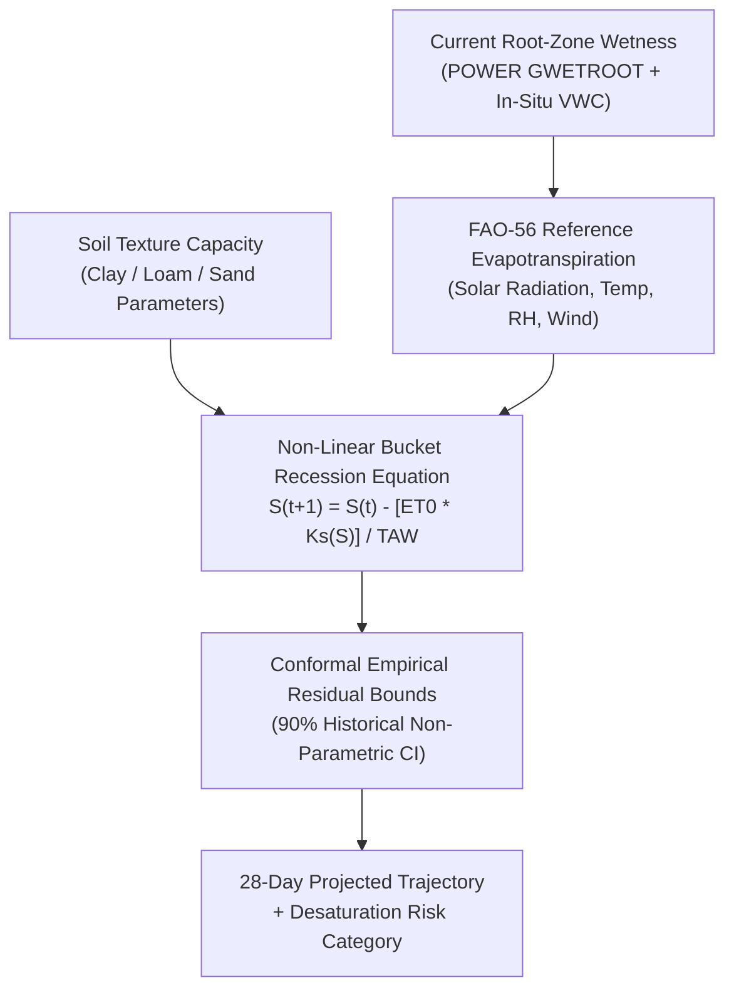

# ⚡ Physics-Informed Hydrological Recession & Conformal Prediction

> [!NOTE] Design Principle: Physics Over Black-Box ML
> Pure neural networks frequently hallucinate unphysical increases in dry-season soil moisture without precipitation. Garvesty fuses **FAO-56 Penman-Monteith physical bucket dynamics** with **conformal uncertainty calibration** to guarantee monotonicity during rain-free recession while providing non-parametric 90% confidence intervals.

---

## 1. Physics Bucket Depletion Equation
For day $t$, given root-zone fractional wetness $S_t \in [0, 1]$:

$$S_{t+1} = \max\left(S_{\text{residual}},\, S_t - \frac{\text{ET}_0(t) \cdot K_s(S_t)}{\text{TAW}}\right)$$

Where:
- $\text{ET}_0(t)$: Daily reference evapotranspiration ($\text{mm/day}$) calculated via Hargreaves-Samani / FAO-56.
- $\text{TAW}$: Total Available Water capacity based on soil texture ($\text{mm}$ per root zone depth).
  - Clay: $\approx 180\text{ mm}$
  - Silty Clay / Loam: $\approx 150\text{ mm}$
  - Sandy Loam: $\approx 100\text{ mm}$
- $K_s(S_t)$: Soil water stress coefficient:
  $$K_s(S_t) = \begin{cases} 1.0 & \text{if } S_t \ge 0.50 \\ \frac{S_t - S_{\text{wilt}}}{0.50 - S_{\text{wilt}}} & \text{if } S_{\text{wilt}} \le S_t < 0.50 \\ 0.0 & \text{if } S_t < S_{\text{wilt}} \end{cases}$$
- $S_{\text{residual}}$: Permanent wilting fraction ($\approx 0.15 - 0.20$).

---

## 2. Conformal Prediction 90% Intervals
Rather than assuming Gaussian distributed errors, we compute empirical nonconformity scores:
$$R_i = |y_i - \hat{y}_i|$$
from the purged chronological validation split ($n = 414$ test samples).
The 90th percentile quantile $\hat{q}_{0.90}$ scales with forecast lead-time $\tau$:
$$\text{Lower}_{\tau} = \hat{S}_{\tau} - \hat{q}_{0.90} \cdot \sqrt{\frac{\tau}{7}}$$
$$\text{Upper}_{\tau} = \min\left(1.0,\, \hat{S}_{\tau} + \hat{q}_{0.90} \cdot \sqrt{\frac{\tau}{7}}\right)$$

---

## 3. Desaturation Risk Categories
- **Low Risk**: $S_{t=28} \ge 0.50$. Ample residual moisture for black gram or green gram taproot establishment.
- **Moderate Risk**: $0.35 \le S_{t=28} < 0.50$. Fast-sowing advised immediately after monsoon paddy drainage.
- **Critical Risk**: $S_{t=28} < 0.35$. High failure probability without supplemental irrigation.

---
*Back to: [[Garvesty_Hub]]*
