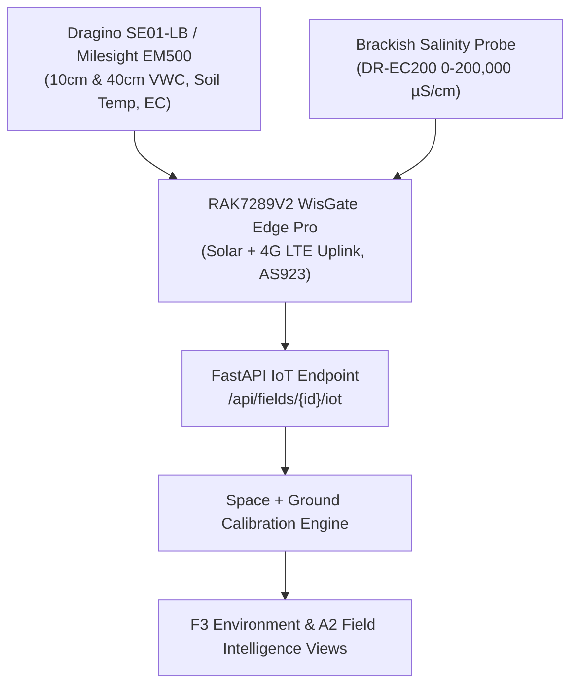

# 📡 In-Situ IoT Sensor Mesh & Ground Truth Telemetry

> [!WARNING] Hardware Reality Check: Phase 2 Strategy
> Commercial sensor deployments in the Ayeyarwady Delta must withstand monsoon flooding, corrosive brackish water, 35°C+ direct solar heating, and 100% relative humidity. In the prototype UI, telemetry values carry a transparent **DEMO / SIMULATED IN-SITU** badge.

---

## 1. Selected Hardware Architecture (Ayeyarwady Delta Specifications)

| Category | Recommended Hardware | Key Technical Specifications | Environmental Hardening |
|---|---|---|---|
| **Soil Moisture & EC** | **Milesight EM500-SMTC** | VWC 0–100%, EC 0–20,000 µS/cm, Temp -40 to +85°C | IP67 radio housing, **IP68 submerged probe**, 19,000 mAh Li-SOCl2 (up to 10-year battery life) |
| **Budget Soil Node** | **Dragino SE01-LB** | Soil moisture + EC, LoRaWAN v1.0.3 Class A | IP66 weather-resistant enclosure, internal 8,500 mAh battery |
| **Brackish Salinity** | **Dragino WQS-LB + DR-EC200** | High EC range: 1 to 200,000 µS/cm (0 to 70 PSU seawater) | 4-electrode anti-polarization probe designed for coastal estuaries |
| **Township Gateway** | **RAK7289V2 WisGate Edge Pro** | 16-channel outdoor gateway, PoE / 12V DC input | IP67 aluminium casing, external lightning arresters, solar + battery |

---

## 2. Radio Band & Frequency Plan (Myanmar)
- **Regional Profile:** **AS923-1 (919–924 MHz)** according to LoRa Alliance RP002-1.0.3.
- **Range:** $12 - 15\text{ km}$ line-of-sight across flat Delta paddy terrain with elevated gateway antenna.
- **Payload Structure:** 12-byte packed binary telemetry transmitted every 60 minutes.

---

## 3. Threshold Alerting Rules
- **Severe Salinity Intrusion**: Electrical Conductivity $\ge 4.0\text{ dS/m}$ ($4,000\text{ \mu S/cm}$). Triggers immediate warning against canal irrigation intake for dry-season crops.
- **Waterlogging / Anoxia Alert**: 10cm Volumetric Water Content $\ge 48\%$ continuously for $> 48\text{ hours}$.
- **Root-Zone Desaturation**: 40cm VWC $< 18\%$. Signals that residual soil moisture is exhausted and emergency irrigation is required.

---
*Back to: [[Garvesty_Hub]]*
