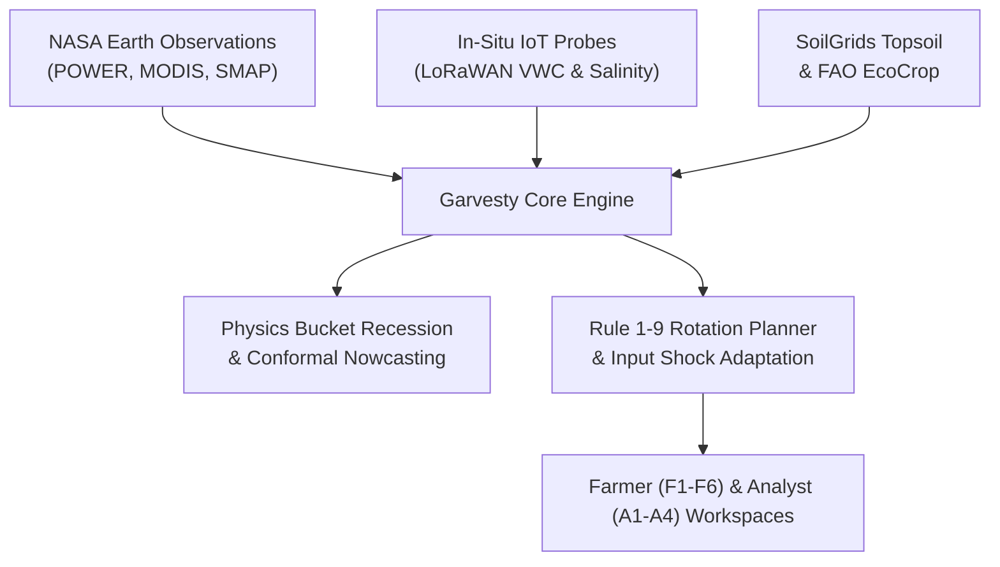

# 🌾 Garvesty — Master Knowledge Hub
> **NASA Space Apps Challenge 2026 — Challenge 07: Field Shift: Adapting Farms with NASA Data**  
> *Space+Ground Fused Agricultural Decision-Support System for the Ayeyarwady Delta & Central Dry Zone.*

---

## 🗺️ Core Knowledge Areas

### 1. 🛰️ [[NASA_Earth_Observations|NASA Earth Observations]]
- **NASA POWER**: Meteorological daily time series (25-year climatology, MERRA-2/GEOS model, 0.5° × 0.625° grid).
- **MODIS Terra MOD13Q1**: 250m 16-day NDVI / EVI with pixel reliability screening.
- **NASA SMAP SPL3SMP_E**: 9km district-scale surface soil moisture.
- **ISRIC SoilGrids v2.0**: Topsoil pH, clay, silt, sand, and organic carbon (0–5 cm depth).
- **FAO EcoCrop**: Biological crop tolerance limits.
*See: [[NASA_Earth_Observations]], [[Data_Provenance_and_Attribution]]*

### 2. ⚡ [[Physics_and_Timeseries_Hydrology|Physics & Time-Series Hydrology]]
- **Physics Bucket Recession**: FAO-56 Penman-Monteith daily reference evapotranspiration (PET) water-balance depletion.
- **Conformal Prediction Intervals**: 90% non-parametric confidence bands calibrated on historical weather.
- **Desaturation Risk Index**: Time-to-wilting horizon for post-monsoon legume establishment.
*See: [[Physics_and_Timeseries_Hydrology]], [[Conformal_Prediction_Calibration]]*

### 3. 📡 [[IoT_Ground_Truth_Sensor_Mesh|In-Situ IoT Sensor Mesh]]
- **LoRaWAN AS923 Deployment**: Ayeyarwady Delta field gateway specs (15km radius).
- **Dual-Depth Probes**: 10cm surface & 40cm root-zone volumetric water content (VWC).
- **Salinity Alerting**: Electrical conductivity (EC in dS/m) for brackish dry-season tidal intrusion.
- **Hardware Shortlist**: Dragino SE01-LB, Milesight EM500-SMTC, RAK WisGate Edge.
*See: [[IoT_Ground_Truth_Sensor_Mesh]], [[Salinity_Intrusion_Dynamics]]*

### 4. ⚖️ [[Deterministic_Rotation_Rules|Deterministic Rotation Rules & Shock Adaptation]]
- **Rules 1–8**: Seasonal fit, legume nitrogen credit, paddy-pulse pest break, soil pH tolerance, water budget, diversity score.
- **Rule 9 (Input-Shock Adaptation)**:
  - Fertilizer unavailable/expensive $\to$ Legumes prioritized (+8 to +12 pts), high-input crops penalized.
  - Pesticide unavailable $\to$ Real crop-family breaks rewarded (+6 pts), monoculture penalized (-8 pts).
  - Cash tight $\to$ Low bought-input crops rise (+6 pts).
*See: [[Deterministic_Rotation_Rules]], [[Rule_9_Input_Shock_Adaptation]]*

### 5. 🖥️ [[System_Architecture|System Architecture & Workspaces]]
- **Farmer Workspace (F1–F6)**: Overview, My Farm, Environment (Past/Present/Future), Compare Rotations, Scenario Simulator, Recommendation Report.
- **Analyst Workspace (A1–A4)**: Regional Observations, Field Intelligence (IoT Fusion & Conformal Bands), Dataset Catalogue, Gated Model Verification.
- **Backend API**: FastAPI, Pydantic, pyarrow / pandas Parquet engine.
*See: [[System_Architecture]], [[Workspaces_F1_to_A4]]*

---

## 🔗 Key Links & References
- [[Submission_Notes_and_Pitch|Submission Notes & Pitch Deck]]
- [[References_and_Citations|Official NASA & Agronomy Citations]]
- [[AGENTS|Antigravity Vault Rules & Instructions]]
