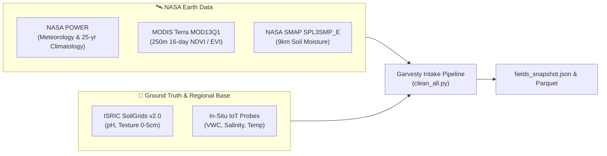

# 🛰️ NASA Earth Observations & SoilGrids Data Layer

> [!INFO] Ground Resolution vs Field Reality
> NASA satellites provide regional observation grids (0.5° for POWER, 9km for SMAP, 250m for MODIS). They reflect regional climate and vegetation trends, not individual farm-plot boundaries. Local soil pH and in-situ IoT probes ground the satellite data into field reality.

---

## 1. NASA POWER (Prediction Of Worldwide Energy Resources)
- **Product:** Daily API v2, Community AG (MERRA-2 / GEOS assimilation).
- **Spatial Resolution:** 0.5° latitude $\times$ 0.625° longitude ($\approx 55 \times 67\text{ km}$).
- **Key Parameters Ingested:**
  - `T2M`: Temperature at 2m (°C).
  - `T2M_MAX` / `T2M_MIN`: Daily maximum and minimum temperatures.
  - `PRECTOTCORR`: Precipitation corrected ($\text{mm/day}$).
  - `GWETROOT`: Root-zone soil wetness fraction ($0.0 = \text{dry}, 1.0 = \text{saturated}$).
  - `GWETTOP`: Surface soil wetness fraction ($0.0 - 1.0$).
  - `ALLSKY_SFC_SW_DWN`: All-sky solar irradiance ($\text{MJ/m}^2/\text{day}$).
- **Status:** `CACHED` / `LIVE` when near-real-time API responds.

---

## 2. MODIS Terra (MOD13Q1 v061)
- **Product:** 16-day composite Vegetation Indices at 250m resolution.
- **Variables:** `250m_16_days_NDVI`, `250m_16_days_EVI`.
- **Quality Assurance Screening:**
  - `pixel_reliability`: Only pixels with flag `0` (Good) or `1` (Marginal) are retained.
  - Flags `2` (Snow/Ice), `3` (Cloud), and `-1` (Fill) are rejected.
  - NDVI values outside $[-0.2, 1.0]$ are treated as invalid fill.

---

## 3. NASA SMAP (SPL3SMP_E v006)
- **Product:** Enhanced Radiometer L3 Global Daily 9km EASE-Grid Soil Moisture.
- **Variables:** AM (`soil_moisture`) and PM (`soil_moisture_pm`) in $\text{cm}^3/\text{cm}^3$.
- **Quality Flags:** Screened against retrieval flags `0` and `8` with valid physical range $0.0 - 0.6$.

---

## 4. ISRIC SoilGrids v2.0 (Non-NASA Ground Layer)
- **Product:** 250m machine-learning global soil map.
- **Depth:** $0 - 5\text{ cm}$ (topsoil).
- **Parameters:**
  - `phh2o`: Soil pH in $\text{H}_2\text{O}$ (must fall in realistic range $3.0 - 10.0$).
  - `clay`, `silt`, `sand`: Texture percentages for hydrological bucket capacity.
  - `soc`: Soil organic carbon ($\text{g/kg}$).

---
*Back to: [[Garvesty_Hub]]*
