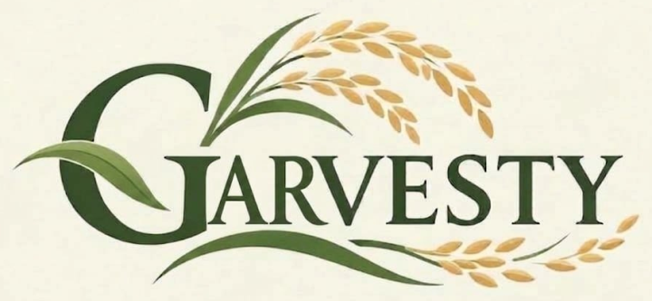

# Submission notes

**Event:** NASA Space Apps Challenge 2026, Yangon
**Challenge:** 07 - Field Shift: Adapting Farms with NASA Data
**Project:** Garvesty - seasonal crop-rotation decision support for the Ayeyarwady Delta
**Team:** Garvesty
**Public demo (no login):** https://alphathanlwin.github.io/NASA/
**Source:** https://github.com/Alphathanlwin/NASA

## What the judges can do in five minutes

1. Open the public URL. It loads in English with no login and no backend.
2. **Home**: pick a field. Note the key conditions, each with its NASA source and status, and the
   recommended dry-season crop.
3. **My Fields**: expand any value to see dataset, product, variable, unit, resolution, period,
   retrieval time and status. Tap **(?)** next to soil pH for the picture guide.
4. **Field view**: press **Plant this** on a rotation. The harvester cuts the rice, the farmer sows
   the next crop, and the season runs on NASA normals to a summary against rice-to-rice.
5. **Crop Planner**: three rotations with reasons; the fertiliser chart for each.
6. **Scenarios**: choose a 14-day planting delay. Rice-to-rice falls from 14.7 to 11.2 while the
   legumes hold.
7. Switch to Burmese with the toggle or `?lang=my`.

## What is included

- Four demo fields, one per reference town, at real coordinates with illustrative geometry.
- NASA POWER recent weather and temperature normals, NASA GPM IMERG rainfall (Late run daily for
  the last 30 days; monthly 2001-2025 for long-term averages), NASA SMAP soil moisture, MODIS NDVI,
  SoilGrids topsoil, source catalogue and cleaning report.
- A 3D field built in Blender with a harvester and an animated season; a cited fertiliser guide;
  a soil pH test guide.
- A deterministic rules engine with a Python canonical implementation and a parity-tested
  TypeScript port.
- Twelve hero scenarios and a what-if comparison screen.
- A deterministic nine-step agent log with a clearly labelled visual metaphor.
- English and Burmese UI strings, self-hosted Myanmar font, acres only.
- A static snapshot build that works with the backend stopped.

## Deliberate limitations

- No yield, profit, or price prediction. Income ranks farmer-entered numbers only.
- SMAP has no recommended-quality reading for the Twante cell in the last 120 days; that field shows
  `UNAVAILABLE` and lists it as missing information.
- Salinity is not in these datasets.
- Field geometry, crop history and irrigation flags are `DEMO`.
- Crop rules have not been reviewed by a local agronomist; the `verified` flag separates FAO
  EcoCrop ranges from team assumptions.
- The Burmese dictionary is a first draft and has not been reviewed by a native speaker.
- The map uses keyless OpenStreetMap tiles because CARTO's keyless light basemap was retired in
  2026. The Satellite view uses Esri World Imagery (not NASA), credited on the map.

- Fertiliser amounts are not predicted. The Fertiliser guide shows the Department of Agriculture's
  published trial rate for black gram and mung bean with its source; rice shows no rate because the
  original could not be checked.

## Soil-moisture model (trained, not shipped)

`backend/app/ml/soil_moisture.py` trains a model that estimates NASA SMAP topsoil moisture from NASA
POWER daily weather, to fill days and places SMAP misses. It is judged on sites it never saw
(leave-one-site-out, with tuning inside each fold) and on later months, against two baselines.

Result on 14 Nov 2026: only 111 SMAP readings from 3 of 13 Delta sites passed the 'recommended'
quality flag. Eleven algorithms were tuned and tested (ridge, lasso, elastic net, k-nearest
neighbours, support vector regression, random forest, extra trees, gradient boosting, histogram
boosting, Gaussian process, neural network). Lasso scored best on unseen sites (RMSE 0.097 m3/m3)
against 0.098 for simply rescaling POWER's own soil wetness, but that winner was picked after
seeing the test scores. When the algorithm is chosen without seeing the held-out site (nested
selection), the error is 0.109, worse than the baseline. So the app does not show model estimates. Full numbers: `data/models/soil_moisture_model.json`.
More years of SMAP history (2015 onwards) are the obvious next step.

## Future work: a fertiliser model

A model that recommends fertiliser for a specific field, to keep the soil healthy over many seasons,
needs data this prototype does not have: Delta trial plots or farmer fields where the fertiliser
applied, soil tests before and after, and the harvest are recorded over several seasons, ideally
collected with township extension officers. With that data a model could be trained on part of the
fields and judged on fields it has never seen, season by season, before any number is shown to a
farmer. Until then Garvesty shows published rates with their source and does not calculate one.

## AI disclosure

Claude Code (Anthropic) was used as a coding assistant for the pipeline, engines, tests, React
interface and documentation. The app makes no LLM calls at runtime. All displayed environmental
values come from the project datasets and the deterministic engine. AI-assisted files carry an
`AI-assisted: Claude Code` header.

## Before a real pilot

The open questions in the project brief still apply: which townships and boundaries, which local
extension partner reviews the crop rules, how farmer consent and crop history are collected, which
local soil and salinity data are trustworthy, and which Burmese terms and units farmers actually
use. Until those are answered this is a prototype decision-support tool, not a validated advisory
service.
